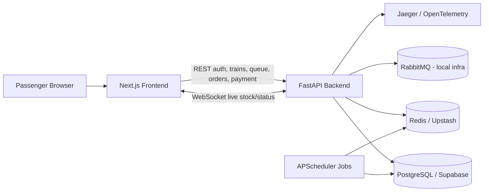

# Tatkal Booking Engine

A full-stack railway Tatkal booking simulation built like a flash-sale system. It combines a Next.js passenger UI, FastAPI backend, PostgreSQL persistence, Redis queue/stock control, WebSocket live updates, Docker, CI, k6 load testing, and optional OpenTelemetry tracing.

## Live Demo

- Frontend: https://tatkal-frontend.vercel.app
- Backend API: https://tatkal-backend-2874.onrender.com
- API docs: https://tatkal-backend-2874.onrender.com/docs

Note: the backend runs on Render free tier, so the first request after inactivity can take a short cold-start delay.

## What It Does

- Email verification based signup and login
- Railway-style train list UI with classes grouped under one train
- Tatkal profile preparation before the booking window: passenger names, adult count, berth preference, payment type
- Waiting room with live stock/status updates over WebSocket
- Redis-backed queue for high-demand booking windows
- Atomic stock reservation to prevent overselling
- Payment success/failure simulation, seat release, and refund status flow
- Docker Compose local stack with backend, frontend, Postgres, Redis, RabbitMQ, and Jaeger

## Architecture



## Booking Flow

1. Passenger creates an account and verifies email.
2. Passenger logs in and sees available Tatkal train windows.
3. Classes like `2A`, `3A`, and `SL` are grouped under the same train.
4. Passenger saves booking profile before the Tatkal rush.
5. Waiting room receives live stock/status through WebSocket.
6. When the window is live, passenger clicks `Book Tatkal Now`.
7. Backend gates traffic through Redis queue and reserves stock atomically.
8. Passenger pays and receives confirmation/PNR.

## Tech Stack

- Frontend: Next.js, TypeScript, CSS
- Backend: FastAPI, SQLAlchemy, Alembic
- Database: PostgreSQL locally, Supabase in production
- Queue/cache: Redis locally, Upstash Redis in production
- Email: Gmail SMTP fallback; Resend supported when a domain is verified
- Infra: Docker Compose, Render, Vercel
- Observability: OpenTelemetry + Jaeger
- Load testing: k6
- CI: GitHub Actions

## Local Run

From the repository root:

```bash
docker compose up --build
```

Local URLs:

- Frontend: http://localhost:3000
- Backend API: http://localhost:8000
- API docs: http://localhost:8000/docs
- Jaeger tracing UI: http://localhost:16686

## Backend Only

```bash
cd flash-sale-engine
python -m uvicorn app.main:app --reload
```

Main backend modules:

- `app/routers/auth.py`: register, verify email, login, current user
- `app/routers/flash_sales.py`: flash sale creation and listing
- `app/routers/queue.py`: Redis queue join/position APIs
- `app/routers/orders.py`: reserve, pay, refund status
- `app/scheduler.py`: queue promotion and unpaid order cancellation
- `app/tracing.py`: OpenTelemetry instrumentation

## Frontend Only

```bash
cd tatkal-frontend
npm install
npm run dev
```

Frontend env:

```text
NEXT_PUBLIC_API_BASE=http://localhost:8000
```

For production:

```text
NEXT_PUBLIC_API_BASE=https://tatkal-backend-2874.onrender.com
```

## Deployment

Current deployed stack:

- Frontend: Vercel
- Backend: Render Web Service
- Postgres: Supabase Transaction Pooler
- Redis: Upstash Redis TCP/TLS
- Email: Gmail SMTP fallback

### Render Backend

Render service settings:

```text
Language: Docker
Root Directory: flash-sale-engine
Branch: main
Instance Type: Free
```

Environment variables:

```text
DATABASE_URL=<Supabase transaction pooler URI>
REDIS_URL=<Upstash rediss:// TCP URL>
SECRET_KEY=<secure random string>
FRONTEND_ORIGIN=https://tatkal-frontend.vercel.app
SMTP_EMAIL=<gmail address>
SMTP_PASSWORD=<gmail app password>
```

Optional Resend variables:

```text
RESEND_API_KEY=<Resend API key>
RESEND_FROM_EMAIL=TatkalEngine <no-reply@yourdomain.com>
```

The backend Dockerfile runs migrations automatically before starting:

```bash
alembic upgrade head
```

### Vercel Frontend

Vercel project settings:

```text
Root Directory: tatkal-frontend
Framework: Next.js
```

Environment variable:

```text
NEXT_PUBLIC_API_BASE=https://tatkal-backend-2874.onrender.com
```

## Sample Live Flash Sale Payload

Use the backend Swagger docs to create a grouped Tatkal train window. Keep the same train name and change only the class suffix:

```json
{
  "items": [
    {
      "name": "Rajdhani Express - 2A",
      "price": 2200,
      "total_stock": 5,
      "start_time": "2026-08-26T01:45:00",
      "end_time": "2026-08-26T03:45:00",
      "max_per_user": 1
    },
    {
      "name": "Rajdhani Express - 3A",
      "price": 1500,
      "total_stock": 8,
      "start_time": "2026-08-26T01:45:00",
      "end_time": "2026-08-26T03:45:00",
      "max_per_user": 2
    },
    {
      "name": "Rajdhani Express - SL",
      "price": 600,
      "total_stock": 12,
      "start_time": "2026-08-26T01:45:00",
      "end_time": "2026-08-26T03:45:00",
      "max_per_user": 2
    }
  ]
}
```

## WebSocket Live Stock

Waiting-room stock/status updates are pushed from:

```text
ws://localhost:8000/ws/flash-sales/{flash_sale_id}/stock
```

In production the frontend derives the WebSocket URL from `NEXT_PUBLIC_API_BASE`.

## Tracing

When running through Docker Compose, the backend exports traces to Jaeger through OTLP.

Open:

```text
http://localhost:16686
```

Select service:

```text
flash-sale-engine
```

Useful traces to capture:

- `/auth/login`
- `/queue/{flash_sale_id}/join`
- `/orders/`
- `/orders/{order_id}/pay`

## Load Test

Run the full login -> queue -> reserve -> pay flow:

```bash
cd flash-sale-engine
k6 run -e FLASH_SALE_ID=1 -e K6_EMAIL=moyzenjam096@gmail.com -e K6_PASSWORD=abhi12345 load_test.js
```

Optional tuning:

```bash
k6 run -e FLASH_SALE_ID=1 -e K6_VUS=50 -e K6_DURATION=30s load_test.js
```

## CI

GitHub Actions workflow:

```text
.github/workflows/ci.yml
```

It runs:

- Backend dependency install and Python compile check
- Frontend dependency install, lint, and production build

## Resume Signals

- Full-stack Dockerized system with one-command local orchestration
- Redis-backed queue and atomic stock reservation
- WebSocket live stock/status push
- Production deployment on Render, Vercel, Supabase, and Upstash
- OpenTelemetry distributed tracing with Jaeger
- k6 full-flow load test
- GitHub Actions CI for backend and frontend
