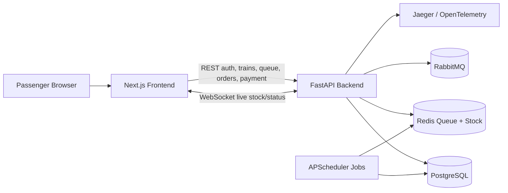

# Tatkal Booking Engine

A full-stack flash-sale style Tatkal booking system with a FastAPI backend, Next.js frontend, Redis queue/stock control, PostgreSQL persistence, k6 load testing, CI, and optional OpenTelemetry tracing through Jaeger.

## One Command Run

From the repository root:

```bash
docker compose up --build
```

Services:

- Frontend: http://localhost:3000
- Backend API: http://localhost:8000
- API docs: http://localhost:8000/docs
- Jaeger tracing UI: http://localhost:16686
- PostgreSQL, Redis, and RabbitMQ run on the internal Docker network for the full stack.

## Architecture



## Booking Flow

1. Passenger logs in.
2. Passenger selects train and class.
3. Passenger saves Tatkal profile: adult count, names, berth preference, payment type.
4. Waiting room receives live stock/status through WebSocket.
5. When the window is live, passenger clicks `Book Tatkal Now`.
6. Backend gates traffic through Redis queue, reserves stock atomically, creates an order.
7. Passenger pays and receives confirmation/PNR.

## Backend

Local run:

```bash
cd flash-sale-engine
python -m uvicorn app.main:app --reload
```

Main components:

- `app/routers/auth.py`: register, verify email, login, current user
- `app/routers/flash_sales.py`: flash sale creation and listing
- `app/routers/queue.py`: Redis queue join/position APIs
- `app/routers/orders.py`: reserve, pay, refund status
- `app/scheduler.py`: queue promotion and unpaid order cancellation
- `app/tracing.py`: OpenTelemetry instrumentation

## Frontend

Local run:

```bash
cd tatkal-frontend
npm install
npm run dev
```

The frontend uses `NEXT_PUBLIC_API_BASE`, defaulting to `http://localhost:8000`.

## Free Demo Deployment

Recommended free/portfolio stack:

- Frontend: Vercel
- Backend: Render Web Service
- Postgres: Supabase Transaction Pooler
- Redis: Upstash Redis TCP/TLS URL
- Email: Resend HTTP API

### Backend On Render

Create a Render Web Service:

```text
Language: Docker
Root Directory: flash-sale-engine
Dockerfile Path: Dockerfile
Instance Type: Free
```

Set these Render environment variables:

```text
DATABASE_URL=<Supabase transaction pooler URI>
REDIS_URL=<Upstash rediss:// TCP URL>
SECRET_KEY=<secure random string>
FRONTEND_ORIGIN=http://localhost:3000
RESEND_API_KEY=<Resend API key>
RESEND_FROM_EMAIL=TatkalEngine <onboarding@resend.dev>
```

After the Vercel frontend is live, update `FRONTEND_ORIGIN` to the Vercel URL:

```text
FRONTEND_ORIGIN=https://your-vercel-app.vercel.app
```

The backend Dockerfile runs migrations automatically before starting:

```bash
alembic upgrade head
```

### Frontend On Vercel

Create a Vercel project:

```text
Root Directory: tatkal-frontend
```

Set:

```text
NEXT_PUBLIC_API_BASE=https://your-render-backend.onrender.com
```

### Production Email Notes

Render free web services should use Resend instead of Gmail SMTP. Gmail SMTP remains as a local fallback only.

If using Resend without a verified domain, emails may only send to your verified Resend account email. For public signup testing, verify a domain in Resend and set:

```text
RESEND_FROM_EMAIL=TatkalEngine <verify@yourdomain.com>
```

## WebSocket Live Stock

Waiting-room stock/status updates are pushed from:

```text
ws://localhost:8000/ws/flash-sales/{flash_sale_id}/stock
```

This replaces frontend polling for the Tatkal waiting screen.

## Tracing

When running through Docker Compose, the backend exports traces to Jaeger via OTLP.

Open:

```text
http://localhost:16686
```

Select service:

```text
flash-sale-engine
```

Useful traces to capture:

- `/auth/login`
- `/queue/{flash_sale_id}/join`
- `/orders/`
- `/orders/{order_id}/pay`

## Load Test

Run the full login -> queue -> reserve -> pay flow:

```bash
cd flash-sale-engine
k6 run -e FLASH_SALE_ID=1 -e K6_EMAIL=moyzenjam096@gmail.com -e K6_PASSWORD=abhi12345 load_test.js
```

Optional tuning:

```bash
k6 run -e FLASH_SALE_ID=1 -e K6_VUS=50 -e K6_DURATION=30s load_test.js
```

## CI

GitHub Actions workflow:

```text
.github/workflows/ci.yml
```

It runs:

- Backend dependency install and Python compile check
- Frontend dependency install, lint, and production build

## Resume Signals

- Dockerized full-stack app with one-command local orchestration
- Redis-backed queue and atomic stock reservation
- WebSocket live stock/status push
- OpenTelemetry distributed tracing with Jaeger
- k6 full-flow load test
- GitHub Actions CI for backend and frontend
